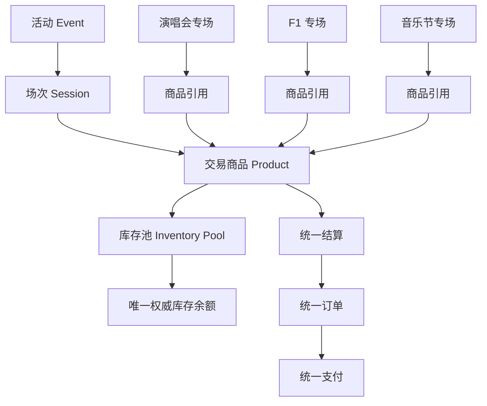
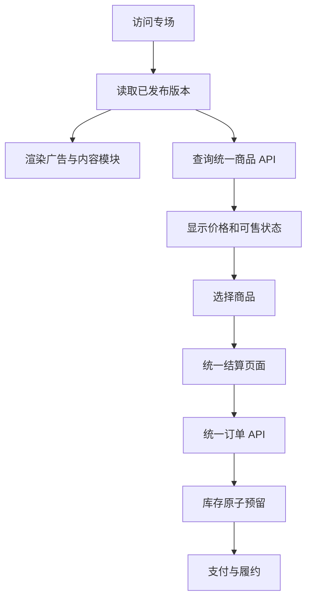

# 专场渲染

专场页面由运营自由组合，购买流程只有一套：统一商品 API → 统一结算 → 统一订单 → 统一支付。

## 业务关系

专场通过"商品引用"组织交易商品，自身不拥有库存和订单实现：



同一个商品可以出现在多个专场里，但只对应同一个库存池或明确关联的库存分配规则。

专场不能把商品复制一份，再给复制品分配虚构库存。

## 专场数据模型

| 表 | 说明 |
|--------|--------|
| `campaigns` | 专场基本信息、标识、状态和当前发布版本 |
| `campaign_revisions` | 不可变的发布版本及配置快照 |
| `campaign_events` | 专场引用的活动和排序 |
| `campaign_products` | 专场引用的商品和展示排序 |
| `campaign_assets` | 专场所使用的图片、视频等资源 |

专场状态：

```text
DRAFT
  → VALIDATED
  → PUBLISHED
  → UNPUBLISHED
  → ARCHIVED
```

草稿被修改后，需要重新验证再发布。**已发布版本不应因为运营人员编辑草稿而被直接覆盖。**

## 页面配置

页面配置以 `schemaVersion` 版本化的配置结构描述（Java record + 手写校验器），由前端"专场模板渲染器"按版本渲染。示例（F1 专场）：

```json
{
  "schemaVersion": 1,
  "template": "motorsport",
  "seo": {
    "title": "AWN F1 专场",
    "description": "查看赛事、票档与公开票务动态"
  },
  "sections": [
    {
      "id": "hero",
      "type": "heroBanner",
      "props": {
        "assetId": "asset_001",
        "title": "F1 赛事专场"
      }
    },
    {
      "id": "event-list",
      "type": "eventList",
      "props": {
        "eventIds": ["event_001"]
      }
    },
    {
      "id": "tickets",
      "type": "ticketGrid",
      "props": {
        "eventIds": ["event_001"]
      }
    },
    {
      "id": "price-history",
      "type": "priceTrend",
      "props": {
        "eventId": "event_001"
      }
    },
    {
      "id": "rules",
      "type": "rulePanel",
      "props": {
        "rules": ["凭电子票入场", "禁止携带外区食品"]
      }
    }
  ]
}
```

初期只提供**受控的模块白名单**：

- `heroBanner`
- `richText`
- `imageGallery`
- `videoEmbed`
- `eventList`
- `ticketGrid`
- `ticketComparison`
- `priceTrend`
- `channelComparison`
- `countdown`
- `rulePanel`
- `faq`
- `noticeBar`

**不要让运营人员通过配置注入任意 JavaScript 或 HTML。**

## 页面模块与交易服务的关系



关键规则：

- 商品卡片上的库存信息可以是**缓存展示值**，但点击购买后必须重新校验真实库存。
- 页面组件不得自行执行库存扣减。
- 不得通过专场配置覆盖成交价格、退款规则或真实供货状态。

## 多端渲染

专场配置由统一的渲染契约驱动，各端共享同一份 `schemaVersion` 语义：

| 端 | 实现 | 说明 |
|--------|--------|--------|
| 网页端 | `packages/campaign-renderer`（Next.js SSR/SSG） | 承担 SEO 与首发流量 |
| 小程序 | Taro 实现同一模块白名单的子集 | 模块能力按平台降级 |
| 客户端 | Flutter 按渲染契约实现原生组件 | 长期运营的用户入口 |
| 管理后台 | `apps/admin` 专场编辑器 | 草稿 / 校验 / 发布 / 下线 |

## 预置实例与种子脚本

三套已批准原型对应三套专场实例（原型过目已代决，demo-note 标注「数据为示例」）：

| 专场码 | 实例 | 内容出处 |
|--------|--------|--------|
| `f1-2026-china` | 2026 F1 中国大奖赛 | `docs/design/prototypes/web/activity-f1.html` |
| `jay-carnival-2026` | 周杰伦「嘉年华」世界巡回演唱会 | `docs/design/prototypes/web/activity-jay.html` |
| `zcx-shibuzhigui-2026` | 周传雄「时不知归」巡回演唱会 | `docs/design/prototypes/web/activity-zcx.html` |

`scripts/seed-demo-campaigns.mjs` 走专场管理写接口（create → draft → validate → publish，
`X-Admin-Token` 鉴权）把 `scripts/seed/demo-campaigns.mjs` 的内容创建为已发布专场：

```bash
AWN_API_BASE=http://localhost:8080 AWN_ADMIN_TOKEN=awn-admin-dev-token \
  node scripts/seed-demo-campaigns.mjs            # 幂等：已存在则复用并重新发布
node scripts/seed-demo-campaigns.mjs --dry-run    # 只打印载荷
```

两条红线写进种子内容并由测试（`scripts/seed/demo-campaigns.test.mjs`）守住：

- **素材红线**：不含 `imageGallery` / `videoEmbed` 区块与任何媒体引用键
  （`url` / `src` / `poster` / `assetId`），视觉一律文字占位。
- **不造假数据**：场次列表 / 票档区块引用占位活动 id `'0'`（不存在），公开解析层
  按「待接入」渲染并说明原因；运营在目录创建真实活动后，回填真实 `eventId`
  再走 draft → validate → publish。
