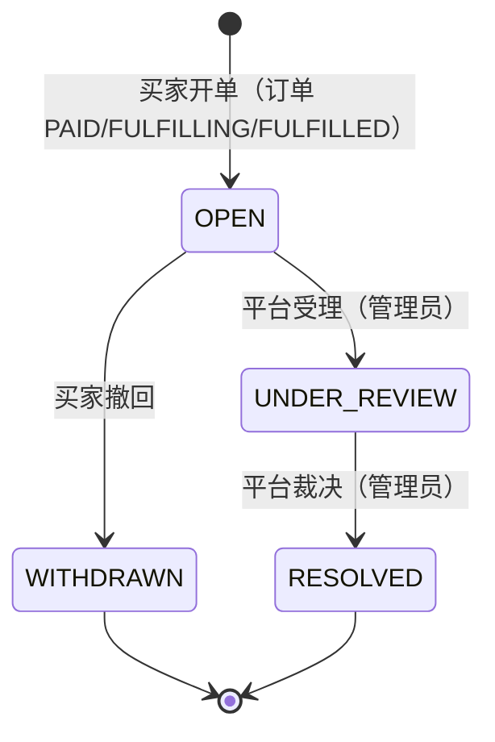

# 争议处理（买卖双方争议受理与裁决）

Phase 05（todo P05）。第三方挂牌交付后，买家可能遇到卖家不交付、票品无效、与描述不符等问题；
此前平台没有争议通道，买卖双方只能线下协商。本文档先立设计：争议单模型、状态机、裁决权限，
再按此实现（2026-10-15）。

## 范围与边界

**本期做：** 争议单的受理（OPEN → UNDER_REVIEW）与裁决（UNDER_REVIEW → RESOLVED），
买家开单与撤回，管理员裁决三种结论（退款 / 重新交付 / 驳回）。

**有意不做（边界，不是遗漏）：**

- **裁决不直接动钱。** 裁决结论只记录在争议单上；退款执行仍走支付模块既有退款流
  （`POST /api/v1/orders/{orderId}/refunds`，幂等键 + 金额上限 + 状态机守卫），
  重新交付仍走履约面。争议模块不依赖 payment 模块：裁决与资金解耦，
  避免支付单不在 SUCCEEDED 时裁决整体回滚，也让退款重试与争议结论互不干扰。
  管理员裁决 REFUND_APPROVED 后按既有退款流程执行。
- **卖家 HTTP 面不在本期。** MarketplaceFacade 目前没有任何控制器（卖家资料、挂牌均为模块内接口），
  卖家回执 / 申辩随卖家 HTTP 端点一并落地（与 todo 中 delist 卖家归属校验同批）。
- **买家身份沿用现状。** 交易面当前无认证中间件，买家以请求体 userId 声明身份，
  服务端校验「声明者必须是订单本人」（`order.userId` 一致性）；
  认证接入（V15 identity 表已建）后此处换成真实主体，守卫逻辑不变。
- **订单状态机不受争议影响。** 争议是订单旁路记录，不阻塞支付 / 履约 / 退款迁移；
  争议期间订单照常推进。

## 争议单模型

一张订单同一时间至多一张在途争议（应用层判重 + 数据库部分唯一索引兜底并发）。
买家按订单开争议，卖家归属在开单时从凭证型订单行解析落库（快照，不随挂牌变动回写）：

```sql
CREATE TABLE order_disputes (
    id                   BIGINT GENERATED ALWAYS AS IDENTITY PRIMARY KEY,
    dispute_no           VARCHAR(64) NOT NULL UNIQUE,          -- DSP-<uuid>
    order_no             VARCHAR(64) NOT NULL REFERENCES orders (order_no),
    opened_by            BIGINT      NOT NULL,                 -- 开单人 = 订单买家（服务端校验）
    seller_id            BIGINT,                               -- 凭证行挂牌卖家快照；纯平台库存行为 NULL
    listing_no           VARCHAR(64),                          -- 争议针对的凭证行
    unit_no              VARCHAR(64),
    reason               VARCHAR(32) NOT NULL
                         CHECK (reason IN ('NOT_DELIVERED', 'TICKET_INVALID',
                                           'DESCRIPTION_MISMATCH', 'OTHER')),
    description          TEXT        NOT NULL,
    evidence_url         TEXT,                                 -- 受控存储域白名单（StorageUrlValidator）
    requested_resolution VARCHAR(16) NOT NULL
                         CHECK (requested_resolution IN ('REFUND', 'REDELIVER')),
    requested_amount     BIGINT,                               -- REFUND 必填且 ≤ 订单应付；REDELIVER 必须为空
    status               VARCHAR(16) NOT NULL DEFAULT 'OPEN'
                         CHECK (status IN ('OPEN', 'UNDER_REVIEW', 'WITHDRAWN', 'RESOLVED')),
    resolution           VARCHAR(32),                          -- 裁决结论：REFUND_APPROVED / REDELIVER_APPROVED / REJECTED
    resolution_note      TEXT,
    decided_by           VARCHAR(64),                          -- 裁决管理员
    decided_at           TIMESTAMPTZ,
    created_at           TIMESTAMPTZ NOT NULL DEFAULT now(),
    updated_at           TIMESTAMPTZ NOT NULL DEFAULT now()
);

-- 同订单至多一张在途争议（数据库兜底并发重复开单）
CREATE UNIQUE INDEX ux_order_disputes_open ON order_disputes (order_no)
    WHERE status IN ('OPEN', 'UNDER_REVIEW');
```

- **卖家归属**：订单行含 `listing_no`（凭证型）时，经 MarketplaceFacade 取挂牌卖家，
  与行号一起快照进争议单；纯平台库存行（`pool_code` 型）订单 seller_id 为 NULL，
  争议同样受理（裁决对象是平台自身履约）。
- **金额口径**：`requested_amount` 为最小货币单位整数，REFUND 时服务端校验
  `0 < requested_amount ≤ order.payAmount`（与支付退款同一口径：金额永远由服务端按快照裁决上限）。

## 状态机



| 迁移 | 操作者 | 守卫 |
| --- | --- | --- |
| `* → OPEN` | 买家 | 订单存在且 `order.userId == 声明买家`；订单状态 ∈ {PAID, FULFILLING, FULFILLED}（待支付/已取消/已过期无争议基础，退款中/已退款走退款流）；该订单无在途争议（OPEN/UNDER_REVIEW）；REFUND 必填金额且 ≤ 应付，REDELIVER 不得带金额；evidenceUrl 过存储域白名单 |
| `OPEN → WITHDRAWN` | 买家 | 仅开单本人；UNDER_REVIEW 后不可撤（已受理只能由平台裁决关闭） |
| `OPEN → UNDER_REVIEW` | 管理员 | 状态为 OPEN（重复受理拒绝） |
| `UNDER_REVIEW → RESOLVED` | 管理员 | 状态为 UNDER_REVIEW；resolution ∈ {REFUND_APPROVED, REDELIVER_APPROVED, REJECTED} 且 note 必填 |

非终态只允许上表迁移，非法迁移抛 `OrderDisputeConflictException`（→ 409 DISPUTE_CONFLICT）；
终态（WITHDRAWN / RESOLVED）拒绝一切迁移。受理与裁决是两个动作：
受理表示平台接手（此后买家不能单方面撤回），裁决给出结论并留痕（decided_by / decided_at）。

## 裁决权限

| 动作 | 谁 | 面 |
| --- | --- | --- |
| 开争议 / 撤回 / 查订单争议 | 买家（订单本人） | `/api/v1/orders/**`（公开面，服务端校验买家归属） |
| 列表 / 受理 / 裁决 | 平台管理员 | `/api/v1/admin/disputes/**`（AdminAuthFilter：X-Admin-Token + 限流） |

- 裁决权限收敛在 admin 面：买家与卖家**没有任何**受理或裁决入口，
  AdminAuthFilter 对 `/api/v1/admin/**` 强制 X-Admin-Token，未带 token 一律 401；
- 模块层不重复做权限判断（权限在组合根收口），但迁移守卫保证即使误调用也改不了状态；
- `decided_by` 记录裁决操作者（请求体传入，与 AdminController 既有 actor 口径一致），审计留痕。

## 接口（契约）

买家面：

- `POST /api/v1/orders/{orderNo}/disputes` — 开争议（body：userId / reason / description /
  evidenceUrl? / requestedResolution / requestedAmount?）→ 201 + DisputeView
- `GET /api/v1/orders/{orderNo}/disputes?userId=` — 该订单的争议列表（服务端校验订单归属）
- `POST /api/v1/disputes/{disputeNo}/withdraw` — 撤回（body：userId，须为开单本人）→ DisputeView

管理面（X-Admin-Token）：

- `GET /api/v1/admin/disputes` — 最近争议（新→旧，限 50 条，与 recentOrders 同口径）
- `POST /api/v1/admin/disputes/{disputeNo}/accept` — 受理 → UNDER_REVIEW
- `POST /api/v1/admin/disputes/{disputeNo}/adjudicate` — 裁决（body：actor / resolution /
  note）→ RESOLVED

错误码（枚举新增，与 ApiExceptionHandler 守卫测试同步）：
`DISPUTE_NOT_FOUND(404)`、`DISPUTE_CONFLICT(409)`；复用 `ORDER_NOT_FOUND`、`VALIDATION_FAILED`。

## 模块落点

争议以订单为锚（先例：候补 waitlist 在 awn-order 内），放 **awn-order 模块**：

- `domain/`：`OrderDispute`（实体 + 守卫迁移）、`DisputeStatus`、`DisputeResolution`、
  `OrderDisputeConflictException`、`DisputeNotFoundException`
- `api/`：`DisputeFacade`、`OpenDisputeCommand`、`AdjudicateDisputeCommand`、`DisputeView`
- `application/`：`DisputeService`（开单时经 OrderRepository 读订单快照、经 MarketplaceFacade 解析卖家）
- `infrastructure/`：`OrderDisputeRepository`
- 迁移：`V22__order_disputes.sql`
- 组合根：`apps/awn-api` 的 `DisputeController`（买家面）+ `AdminController` 增管理端点

## 余留

- 卖家回执 / 申辩（随卖家 HTTP 端点落地，见 todo「delist 无卖家归属校验」同批）；
- 裁决 REFUND_APPROVED 后的退款执行联动（目前管理员手动走既有退款端点）；
- 买家争议入口 UI（web 订单页后续迭代）；
- 争议时效（超时自动升级 / 关闭）待运营口径明确后补。
