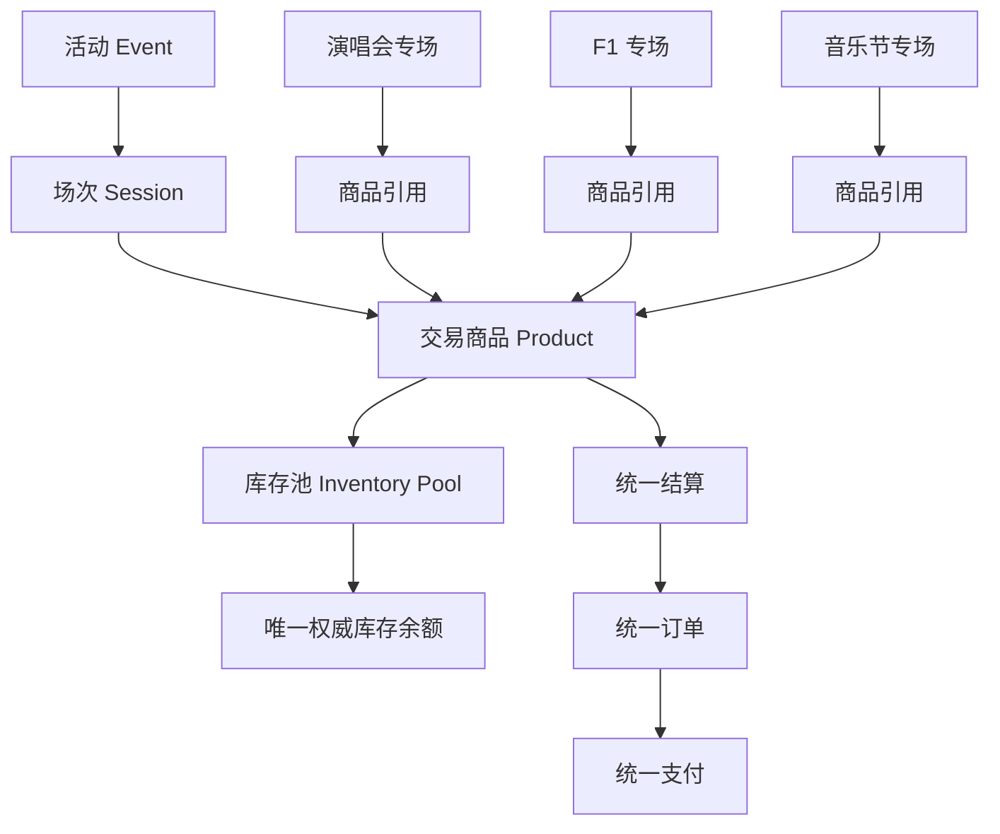

# 领域模型

AWN 的领域模型围绕一条主链展开：**活动 → 场次 → 商品 → 库存池 → 统一结算 → 统一订单 → 统一支付**。专场只是商品的组织与展示层，不参与交易语义。

## 业务关系



同一个商品可以出现在多个专场里，但只对应**同一个库存池**或明确关联的库存分配规则。

专场不能把商品复制一份，再给复制品分配虚构库存。

## 核心数据表

推荐 PostgreSQL 为唯一交易权威数据库。初期使用一个数据库实例，按领域使用清晰的表命名或 Schema。高风险交易逻辑尽量放在同一数据库事务内。

| 领域 | 表 |
|--------|--------|
| 活动 | `events`、`sessions`、`venues` |
| 商品 | `ticket_categories`、`products`、`product_rules` |
| 库存 | `inventory_pools`、`inventory_balances`、`inventory_reservations`、`ticket_units`、`inventory_movements` |
| 专场 | `campaigns`、`campaign_revisions`、`campaign_events`、`campaign_products` |
| 订单 | `orders`、`order_items`、`order_transitions` |
| 支付 | `payments`、`payment_events` |
| 退款 | `refunds`、`refund_events` |
| 履约 | `fulfillments`、`delivery_records` |
| 幂等与事件 | `idempotency_records`、`outbox_messages`、`inbox_messages` |
| 审计 | `audit_logs` |
| 情报 | `data_sources`、`raw_observations`、`normalized_observations`、`price_history` |

## 库存余额模型

数量型库存至少包含：

```text
inventory_balances
  inventory_pool_id
  total_quantity
  reserved_quantity
  sold_quantity
  version
  updated_at
```

核心不变量：

```text
available = total - reserved - sold
```

必须保证：

```text
total >= 0
reserved + sold <= total
```

数据库应通过非负约束和库存上限约束提供最后一道防线。

对于有独立座位、独立二维码或独立票品编号的商品，还需要 `ticket_units` 记录每张票的唯一状态，不能仅依靠数量余额。

## 订单快照

`order_items` 至少需要保存：

```text
order_id
product_id
product_name_snapshot
session_id
ticket_category_snapshot
quantity
unit_price
discount_amount
fee_amount
line_total
```

下单时计算并保存实际成交金额、币种、商品规则版本和必要的供货信息。

**金额使用最小货币单位整数或精确 `NUMERIC` 类型，禁止用浮点数计算实际交易金额。**

## 状态定义

订单状态不能兼任支付状态和履约状态，三者独立管理：

- 订单状态：`PENDING_PAYMENT / PAID / FULFILLING / FULFILLED / REFUND_PENDING / REFUNDED / CANCELLED / EXPIRED`
- 支付状态：`CREATED / PENDING / SUCCEEDED / FAILED / UNKNOWN / REFUNDING / PARTIALLY_REFUNDED / REFUNDED`
- 履约状态：`NOT_STARTED / PENDING_SELLER / PENDING_VERIFICATION / IN_PROGRESS / COMPLETED / FAILED / CANCELLED`

详见 [订单与支付状态机](./payment-state-machine)。
