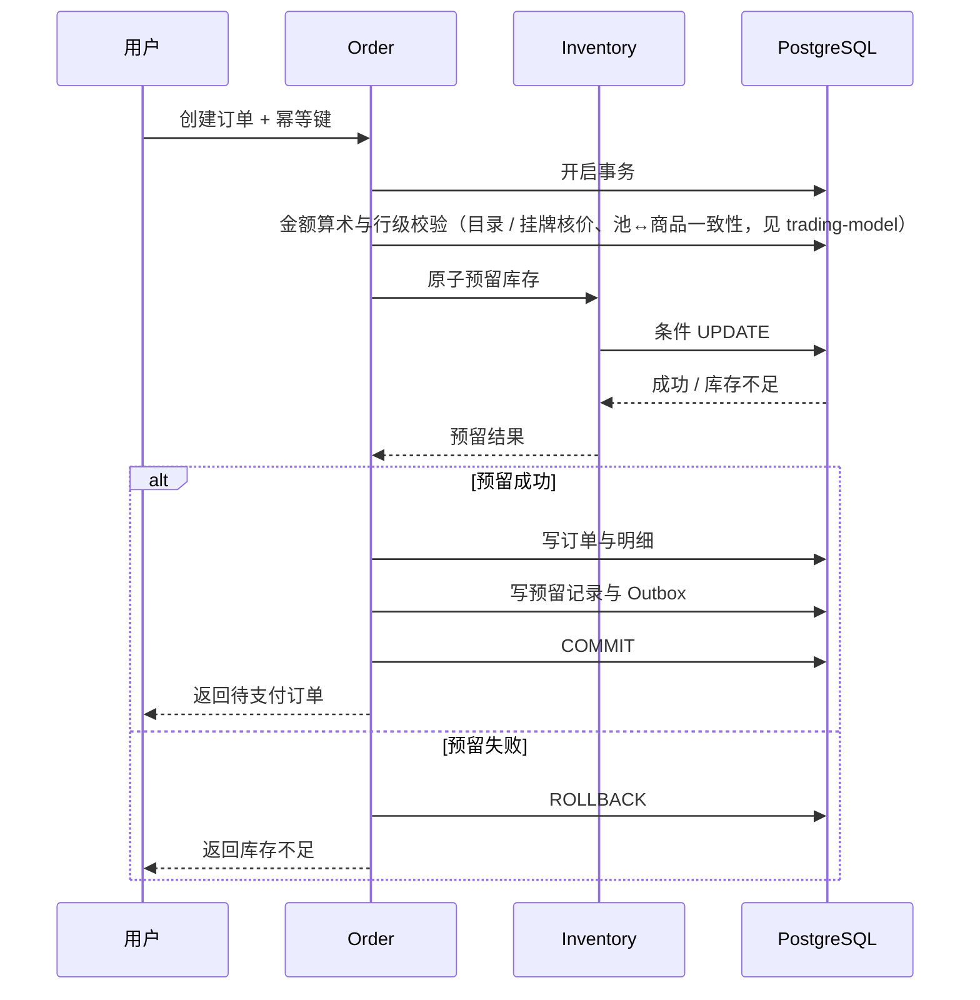

# 库存一致性（防超卖）

本文定义防超卖的事务边界与三层防线。

## 原子预留

不能使用"先查库存，再扣库存"的普通流程。必须在 PostgreSQL 中使用条件更新：

```sql
UPDATE inventory_balance
SET reserved_quantity = reserved_quantity + :quantity,
    version = version + 1
WHERE inventory_pool_id = :poolId
  AND total_quantity - reserved_quantity - sold_quantity >= :quantity;
```

影响行数为 0，预留就失败（`updated_at` 由触发器维护，不在此语句中更新）。

这条 SQL 必须放在真实的数据库事务中，并与订单、预留记录和 Outbox 事件一起提交。

## 不变量

```text
available = total - reserved - sold
total >= 0
reserved + sold <= total
```

数据库通过非负约束和库存上限约束提供最后一道防线，应用层的条件更新是第一道防线，两者缺一不可。

## 订单创建事务



订单和库存预留必须处于**同一个本地事务**中。外部支付请求不能放进数据库事务中长时间等待。

## 库存预留状态

```text
ACTIVE
  ├── CONFIRMED：支付确认并转为已售
  └── RELEASED：合法取消或超时释放
```

### 释放

释放库存时，必须在**同一个事务**中执行：

1. 条件更新预留状态，仅允许 `ACTIVE → RELEASED`。
2. 只有本次状态转换成功时，才减少预留库存。
3. 写入库存流水和必要的业务事件。
4. 提交事务。

重复执行释放任务不会重复加回库存。

### 确认

支付确认必须在同一个事务中完成 `ACTIVE → CONFIRMED`，并同时将预留数量转为已售数量。

## 对账

Worker 定期逐池核对计数器与账本，三类期望值：

```text
reserved = Σ ACTIVE 预留量
sold     = Σ CONFIRMED 预留量
total    = Σ ADJUST 流水
```

总量口径依赖 ADJUST 流水：建池时在同事务内写一条 bootstrap ADJUST，运营调整写带符号的 ADJUST；RESERVE / CONFIRM / RELEASE 不动总量。三类差异分别产出 `RESERVED_MISMATCH`、`SOLD_MISMATCH`、`TOTAL_MISMATCH` 告警。

对账只报告不修复。自动改写计数器会掩盖真正的缺陷（丢流水、重复迁移、越权更新），差异必须先被看见。

## 支付成功与超时释放发生竞态怎么办？

必须由**数据库事务和状态机**共同解决，不能让定时任务与支付回调各自随意更新状态。

特别是支付渠道返回超时、但实际上可能已经扣款的情况：

- 支付单进入 UNKNOWN（待核实）状态，订单保持待支付。
- Worker 查询支付渠道并进行对账，查实后迁移支付单状态（已实现）。
- UNKNOWN 订单仍按订单超时规则释放库存；支付单由 Worker 独立核实，不以不确定的支付状态阻塞库存释放。
- 如果库存已经合法释放，但后来确认支付成功，**不能无条件把订单标记为正常履约成功**。Worker 发出高等级告警并按原路发起幂等全额退款，不恢复库存、不伪装履约（`PaymentFacadeImpl.resolveUnknownPayments`；G6 已关闭）。

::: warning 开放真实支付前逐项核对
防超卖依赖六项同时成立：数据库约束、原子条件 UPDATE、单事务边界、幂等状态转换、支付对账、故障恢复。缺任一项时不得开放真实支付。
:::
