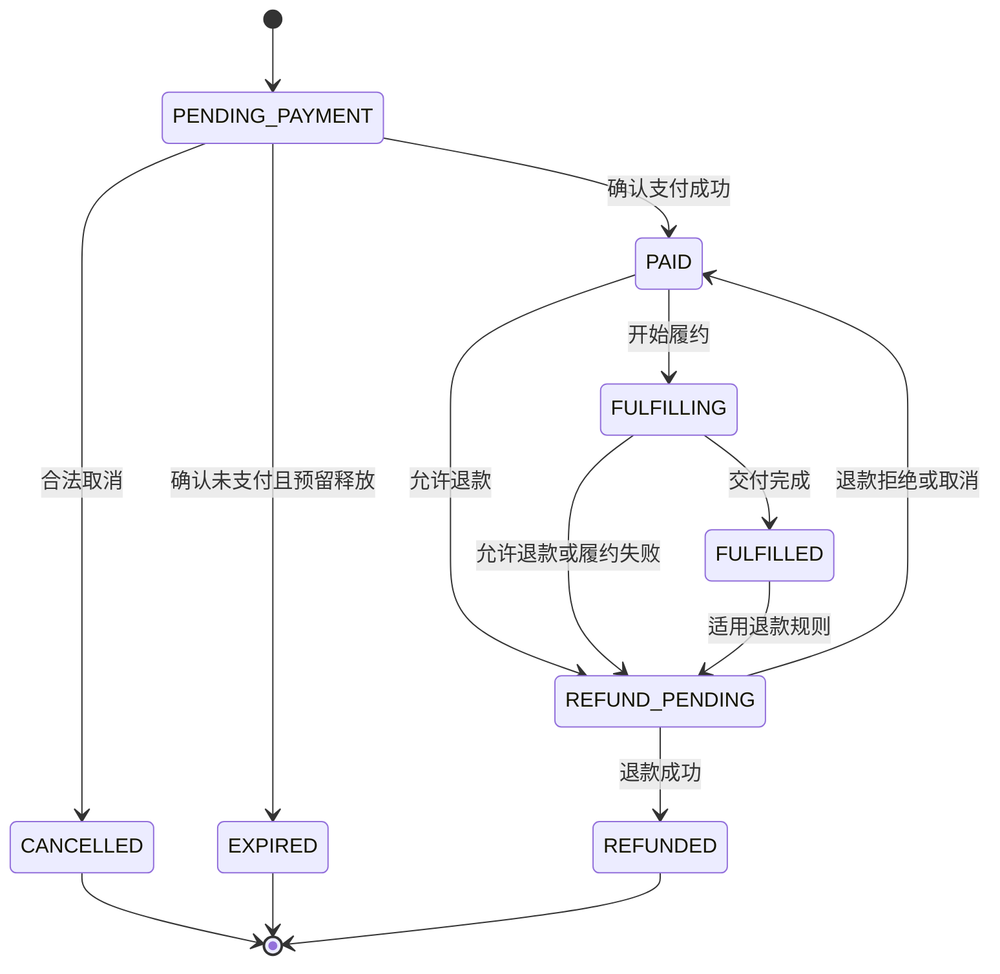

# 订单与支付状态机

订单、支付、履约三套状态**相互独立**，禁止混用。状态转换必须通过领域服务校验，不允许任意 API 直接修改状态字符串。

## 订单状态机



`PAID → FULFILLING → FULFILLED` 由履约事件驱动（2026-10-13 落地）：履约单创建（PENDING_SELLER）时履约模块发出 `FULFILLMENT_STARTED`，订单模块消费后置 FULFILLING；平台核验通过（交付完成）时发出 `FULFILLMENT_COMPLETED`，订单模块消费后置 FULFILLED。两步均为守卫迁移（`OrderWriteService.markFulfilling` / `markFulfilled`），事件重放幂等。

## 支付状态

独立于订单状态管理：

```text
CREATED
PENDING
SUCCEEDED
FAILED
UNKNOWN
REFUNDING
PARTIALLY_REFUNDED
REFUNDED
```

## 履约状态

同样独立管理：

```text
NOT_STARTED
PENDING_SELLER
PENDING_VERIFICATION
IN_PROGRESS
COMPLETED
FAILED
CANCELLED
```

## 退款状态

退款单独立于支付单管理：

```text
CREATED
PENDING
SUCCEEDED
FAILED
UNKNOWN
```

`UNKNOWN` 同样进入渠道查询对账，不盲目重复退款。

## 支付回调幂等

支付模块必须实现：

- 回调签名验证。
- 商户订单号、金额、币种和支付渠道校验。
- 支付渠道交易号唯一约束。
- 重复回调去重。
- 支付成功状态的条件更新。
- 支付事件持久化。
- 支付渠道查询与定期对账。
- 异常状态告警。

**支付成功回调即使到达多次，也只能产生一次有效的业务确认。**

## 退款幂等

退款模块必须有自己的退款编号、渠道退款编号、退款金额、状态和幂等键。

要确保：

- 重复退款请求不会重复发起资金退款。
- 重复退款回调不会重复更新订单或履约。
- 成功退款总金额不能超过可退款金额。
- 部分退款有明确的累计金额校验。
- 退款渠道结果未知时先查询，不盲目再次退款。

## 竞态与异常订单

支付成功与库存释放发生竞争时（例如支付渠道返回超时、但实际上可能已经扣款）：

已实现：

1. 支付单进入 UNKNOWN（待核实）状态，订单保持待支付。
2. Worker 查询支付渠道并对账，把 UNKNOWN 迁移到查实后的状态。
3. 若库存已合法释放后收到成功回调，回调入口只做去重并置 UNKNOWN，不确认迁移、不重复扣减。

已实现（G6）：

1. Worker 查询 UNKNOWN 支付单对应渠道；查实失败则迁移 FAILED，结果仍未知或查询失败则保留 UNKNOWN 等待下轮。
2. 查实成功后按支付状态守卫迁移；若订单已 EXPIRED / CANCELLED，记录 CRITICAL 告警并按原渠道发起全额退款，不恢复库存、不伪装履约。
3. 同一支付单的异常退款使用确定性幂等键，重复核实不会重复退款。详见 `PaymentFacadeImpl.resolveUnknownPayments` / `handleOrderReleasedAfterSuccess` 与 `PaymentModuleTests`。
