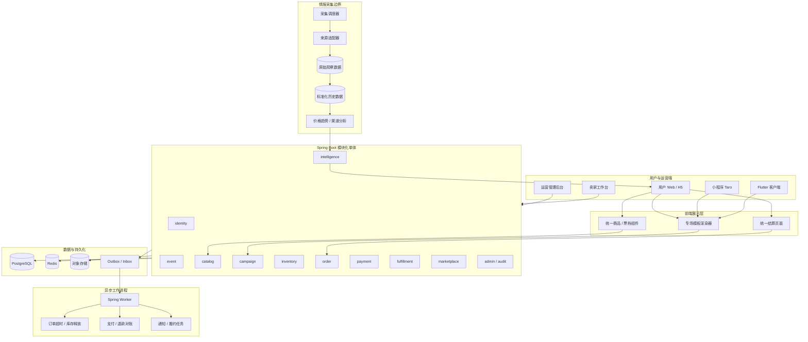

# 系统总览

AWN（麦芒网）是一个面向中国用户的**票务交易与情报平台**，采用 **Java + Spring Boot 模块化单体**架构。

本文档是 AWN 仓库的初始架构规范，定义的是**需要实现和验证的目标架构**，不声明代码已经存在。

## 核心原则

- 专场页面可以千差万别，但**购买链路只有一套**。
- 库存必须通过 PostgreSQL 事务和原子操作保证。
- 支付回调必须幂等。
- 票务情报与真实交易库存严格隔离。

## 最终技术决策

| 层次 | 技术选择 | 设计目的 |
|--------|--------|--------|
| 用户端 | TypeScript + React + Next.js | 活动展示、SEO、专场页面、购票 |
| 小程序 | TypeScript + Taro（React） | 微信等小程序渠道购票 |
| 移动客户端 | Flutter | iOS / Android 用户 App |
| 运营后台 | TypeScript + React | 活动管理、专场编辑、订单运营 |
| 后端 | Java + Spring Boot | 统一业务 API 和交易逻辑 |
| 模块治理 | Spring Modulith | 检查模块依赖、生成架构文档、模块测试 |
| 数据库 | PostgreSQL | 订单、库存、支付和核心业务数据 |
| 数据访问 | Spring Data JPA + JDBC | 普通业务使用 JPA，库存关键操作使用原子 SQL |
| 数据库迁移 | Flyway | 可审计、可重复执行的数据库版本管理 |
| 缓存 | Redis | 缓存、限流、短期辅助状态 |
| 异步处理 | Spring Worker + PostgreSQL Outbox | 订单超时、通知、对账、履约任务 |
| 消息队列 | 第一阶段暂不引入 | 避免在没有实际需求时增加运维复杂度 |
| 文件存储 | S3 兼容对象存储 | 活动图片、专场素材、受控的交付凭证 |
| API 契约 | OpenAPI | 前后端协作和 Code Agent 开发 |
| 测试 | JUnit 5 + Testcontainers | 真实 PostgreSQL 环境下验证事务与并发 |
| 部署 | Docker Compose | 先保持小巧、易部署、易恢复 |

Spring Modulith 专门用于在 Spring Boot 应用中定义和验证逻辑模块，也支持模块级集成测试和架构文档生成，适合 AWN 这种希望先采用单体部署、又不希望代码逐渐耦合成一团的项目。

**不采用微服务作为初始架构。** API、订单、库存、支付和情报模块可以拥有明确的代码边界，但不需要在第一天就成为几十个独立服务。

## 系统总体架构图

AWN 系统分为用户展示、交易核心、异步处理和情报数据四个主要部分：

这里最重要的不是模块数量，而是**三条边界**：

1. 专场只负责展示，不能拥有独立的库存和订单实现。
2. 库存模块是唯一有权执行库存预留、确认和释放的模块。
3. 情报模块只能提供公开数据及分析结果，不能修改交易库存。
