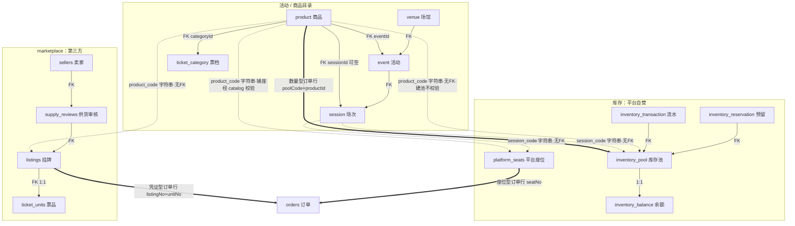

# 交易全链模型

Phase 09 外部评审 P0 项的落地文档：澄清**商品 / 票档 / 票品 / 库存池 / 卖家 / 供货 / 挂牌**的关系，
把四类业务事实钉到数据模型上，给出全链时序与事务边界，并把关键不变量对应到集成测试。

表名一律以 Flyway 迁移为准（`modules/awn-shared/src/main/resources/db/migration/`；命名混用：V2/V4 领域为单数如 `inventory_pool` / `product`，V3 起沿用复数如 `orders` / `listings`）。
本文与 [领域模型](./domain-model) 互补：领域模型讲主链不变式，本文讲"谁交易什么、货从哪来、边界在哪"。

## 四类业务事实与数据模型落点

| 业务事实 | 数据模型落点 | 消费路径 | 现状 |
|---|---|---|---|
| 平台自营票量 | `product` + `inventory_pool`（`(product_id, session_id)` 唯一）+ `inventory_balance` | 下单时原子条件 UPDATE 预留，支付确认转已售 | **已实现**（数量型订单行） |
| 第三方挂牌 | `sellers` → `supply_reviews`（资质审核）→ `listings`（售卖入口）→ `ticket_units`（1:1 票品） | 凭证型订单行下单，票品 IN_STOCK → RESERVED → SOLD（G2 已接通） | **已实现**，有并发抢单与回滚集成测试 |
| 独立票品 | 两个概念必须分开：① 挂牌票品 `ticket_units`（FK→`listings`）；② 平台座位型票品 `platform_seats`（挂场次与商品编码，独立建模，禁止复用 ①） | ① 挂牌生命周期；② 平台逐座交易 | ①② 模型均已实现；① 已接入订单链路（G2），② 逐座下单 / 占座属座位图 L3 后续（用户 2026-10-12 拍板，见 ui-system.md） |
| 外部情报报价 | `intelligence` schema（`data_sources` / `raw_observations` / `normalized_observations` / `price_history`） | 只读展示，永不回写交易表（ADR-0004） | 已实现，权限边界有集成测试 |

## 概念关系



实线 = 数据库外键硬约束；虚线 = 字符串松耦合（无外键，靠约定一致）。

## 关系要点

1. **票档是商品的分类，不是库存单位**：`product.category_id` FK→`ticket_category`，下单时快照进 `order_items.ticket_category_snapshot`。票档不建池、不参与扣减。
2. **库存池只属于平台交易链路**：`(product_id, session_id)` 唯一约束保证同商品同场次只有一个池；池只能由运营在 inventory 模块创建（`createPool` / `adjustPool`），**商品上架不会自动建池**（现状）。marketplace 永远不创建池（模块边界禁令：「未经确认就创建平台可信库存」不允许）。
3. **"票品"有两个概念，禁止混用**：
   - **挂牌票品（已实现）**：`ticket_units.listing_id` FK→`listings`，1:1，是转售场景下唯一编号票的凭证实体，状态机 `IN_STOCK → RESERVED/SOLD/DELIVERED/INVALID` 与挂牌状态解耦。
   - **平台座位型票品（已实现）**：`platform_seats`（V17）挂场次与商品编码（字符串松耦合，与库存池同口径），逐座状态机 `IN_STOCK → RESERVED → SOLD → DELIVERED`，`INVALID` 为作废终态；`SOLD` 必经 `RESERVED`（卖出走预留，占座订单号有落点）；迁移走守卫条件 UPDATE，并发抢座只放行一单。**不复用**挂牌的 `ticket_units`（其外键挂在 `listings` 上，语义是"卖家的票"）。
   旧版领域模型把 `ticket_units` 表述为"座位型商品的数量余额替代"，与实现冲突，已修正。
4. **供货审核是资质，不是库存**：`supply_reviews` APPROVED 只给 `listings.platform_guaranteed = true` 的资格（`Listing.create` 领域工厂强制），**不向任何库存池注入数量**；挂牌也不校验审核 `quantity` 是否已被耗尽（缺口 G4）。
5. **挂牌与订单链路已接通（G2）**：`OrderLineCommand` 支持三种互斥形态——数量型行（`poolCode` + `quantity`）、凭证型行（`listingNo`，`quantity` 必须为 1，`poolCode` 为 null）与座位型行（`seatNo`，`quantity` 必须为 1，V23 落列）。凭证型行下单时把挂牌 `LISTED → RESERVED`、票品 `IN_STOCK → RESERVED`（两条守卫条件 UPDATE，与订单同事务）；支付确认转 SOLD，取消 / 超时释放回 LISTED / IN_STOCK。座位型行同口径走 `platform_seats` 状态机（下单 `reserveSeatForOrder` 含商品归属校验，商品不符 409；支付确认 SOLD，取消 / 超时释放回 IN_STOCK）。并发抢单 / 抢座由守卫迁移裁决，只放行一单。订单行须落库 `listing_no` / `unit_no` 或 `seat_no`，数据库 `CHECK ck_order_item_source` 兜底「一行恰有一条库存路径（三选一）」。
   附带收紧：卖家**不得下架有待支付订单在途的挂牌**（`RESERVED → DELISTED` 被领域工厂拒绝），否则买家下单成功而卖家撤单。
6. **跨模块引用是字符串松耦合**：`inventory_pool.product_id` 存的是 `product_code` 形态的字符串（非 `product.id`，无外键，建池校验见 G1）；`listings.product_code` / `session_code` 同理。订单与库存之间靠 `order_items.pool_code` / `reservation_no` 字符串互指，订单与挂牌之间靠 `order_items.listing_no` / `unit_no` 互指，订单与平台座位之间靠 `order_items.seat_no` 互指，均无外键。这是模块化单体的**有意取舍**（模块间不摸表），但因此：编码写错只能在下单链路暴露，跨模块一致性由应用层校验与对账兜底。
7. **专场永远只引用商品**（`campaign_products` FK→`product`），不能复制商品、不能虚构库存；同一商品跨专场共用同一个池是结构保证，不是巧合。

## 全链时序与事务边界

```mermaid
sequenceDiagram
    autonumber
    participant OP as 运营
    participant CE as catalog/event
    participant MP as marketplace
    participant INV as inventory
    participant ORD as order
    participant PAY as payment+渠道
    participant WK as worker
    participant FUL as fulfillment

    == 活动创建：纯目录事务 ==
    OP->>CE: 建场馆 / 活动 / 场次
    Note over CE: T1 各自本地事务，无跨模块写

    == 商品上架：当前语义 = 建商品 + 建池（G3：无发布 API）==
    OP->>CE: createProduct（硬编码 DRAFT）
    Note over CE: T2 本地事务
    OP->>INV: createPool + adjustPool 定总量
    Note over INV: T3 池 + 余额(1:1) 同事务；不校验商品存在（G1）

    == 卖家供货：marketplace 内部，与平台池无关 ==
    OP->>MP: registerSeller
    卖家->>MP: submitSupplyReview（凭证须白名单存储域）
    Note over MP: T4 本地事务
    OP->>MP: approve / reject（只能从 PENDING 裁决）
    Note over MP: T5 状态迁移 + 审计留痕
    卖家->>MP: createListing（APPROVED 才可 platform_guaranteed）
    Note over MP: T6 挂牌 + 1 张票品(IN_STOCK) 同事务；不校验审核额度（G4）

    == 下单：单一本地事务（防超卖核心）==
    买家->>ORD: createOrder（Idempotency-Key）
    Note over ORD,INV: T7 一个数据库事务：advisory lock → 重放/冲突判定 → 逐行原子预留（条件 UPDATE + 预留记录 + RESERVE 流水）→ 订单 + 明细快照 → ORDER_CREATED Outbox；任一步失败整体回滚

    == 支付 ==
    买家->>PAY: createPayment
    Note over PAY: T8 支付单 + 渠道受理 + markPending（渠道调用在事务内，G5）
    PAY-->>PAY: 渠道异步回调
    Note over PAY: T9 验签 → 定位 → 金额校验 → markSucceeded + PAYMENT_SUCCEEDED Outbox；订单已过期/取消 → markUnknown（不盲目确认，G6）
    WK->>ORD: dispatch PAYMENT_SUCCEEDED
    Note over ORD: T10 PENDING_PAYMENT→PAID + 逐行 confirm 转已售
    WK->>FUL: dispatch PAYMENT_SUCCEEDED
    Note over FUL: T11 建履约单 PENDING_SELLER（一单一履约幂等）；支付成功 ≠ 履约完成

    == 出票 / 交付 ==
    卖家->>FUL: deliverSeller（交付凭证）
    Note over FUL: T12 凭证白名单校验 + DeliveryRecord(PENDING)
    OP->>FUL: verifyDelivery
    alt 核验通过
        Note over FUL: T13 履约 COMPLETED
    else 核验拒绝 / 卖家报损
        Note over FUL: T14 履约 FAILED + FULFILLMENT_FAILED Outbox
        WK->>ORD: dispatch FULFILLMENT_FAILED
        Note over ORD: T15 →REFUND_PENDING
    end

    == 退款 ==
    OP->>PAY: requestRefund（Idempotency-Key）
    Note over PAY: T16 额度守卫（累计占用 + 本次 ≤ 实付）→ 退款单 + 渠道受理 + markPending
    PAY-->>PAY: 退款回调
    Note over PAY: T17 退款终态回写 + 支付单 REFUNDED / PARTIALLY_REFUNDED（超退抛冲突）

    == 超时兜底 ==
    WK->>ORD: OrderTimeoutTask（每单独立事务）
    Note over ORD: T18 PENDING_PAYMENT→EXPIRED，赢者释放库存；不查支付状态，UNKNOWN 同样被释放（查实成功后走 G6 补偿：告警 + 原路幂等退款）
```

事务边界口径：

- **跨模块同事务写有三处：T7（下单）、T10（确认支付后逐行确认）、取消订单**，均在单事务内写 order + inventory + outbox，都受状态机守卫裁决，也是超卖防护的主战场。
- 其余链路是**单模块本地事务**，跨模块只靠 Outbox/Inbox 事件衔接；消费者各自幂等（Inbox 去重 + 状态机守卫 + 数据库唯一约束）。
- 渠道（真实支付网关）永远不在任何本地事务内等待；T8 的渠道调用是沙箱期已知取舍（G5）。

## 不变量 → 集成测试清单

集成测试全部位于 `apps/awn-api/src/test`（真实 PostgreSQL）。

| # | 不变量 | 防线 | 已有测试 | 缺口 |
|---|---|---|---|---|
| 1 | `available = total − reserved − sold`，`reserved + sold ≤ total`，并发不超卖 | DB CHECK + 原子条件 UPDATE | `InventoryConcurrencyTests`（24 线程抢 10 张）、`InventoryStressTests`（混合压测后恒等式成立） | — |
| 2 | 订单 + 预留 + 流水 + Outbox 同事务，任一失败全回滚 | `OrderWriteService.createOrder` 单事务 | `OrderCoreTests.insufficientInventoryRollsBackEverything` | — |
| 3 | 下单幂等：同键重放同单、异请求冲突、并发同键只一单 | advisory lock + `idempotency_key` UNIQUE | `OrderCoreTests`（replay / conflict / 24 线程并发） | — |
| 4 | 预留确认/释放：状态守卫 + 赢者才动余额 + 重放幂等 | `transition` 守卫 UPDATE | `InventoryConcurrencyTests.confirmReleaseLifecycleIsGuardedAndIdempotent` | — |
| 5 | 订单行创建后不可变 | DB 触发器拒绝 UPDATE | `OrderCoreTests.orderItemsAreImmutableAtDatabaseLevel` | — |
| 6 | 订单状态机拒绝非法迁移 | `transition` 守卫 | `OrderCoreTests.stateMachineRejectsIllegalTransitions` | — |
| 7 | 未审核供货不得平台保证，已拒绝供货不得挂牌 | `Listing.create` 领域工厂 | `MarketplaceModuleTests.unapprovedSupplyCannotBePlatformGuaranteed` | — |
| 8 | 供货 / 交付凭证必须白名单存储域 | `StorageUrlValidator` | `MarketplaceModuleTests`、`FulfillmentModuleTests`（各自覆盖） | — |
| 9 | 票品状态与挂牌解耦、非法迁移拒绝 | `TicketUnitStatus.canTransitionTo` | `MarketplaceModuleTests.ticketUnitStatusIsDecoupledFromListing` / `invalidUnitTransitionIsRejected` | — |
| 10 | 支付成功 ≠ 履约完成（停 `PENDING_SELLER`） | 独立履约状态机 | `FulfillmentModuleTests.paymentSuccessCreatesPendingSellerNotCompleted` | — |
| 11 | 一单一履约，事件重投幂等 | Inbox 去重 + `order_no` UNIQUE | `FulfillmentModuleTests.oneFulfillmentPerOrderSurvivesEventRedelivery` | — |
| 12 | 履约失败自动进入订单退款流程 | `FULFILLMENT_FAILED` 事件 | `FulfillmentModuleTests.sellerReportedFailureEntersExceptionFlow` | — |
| 13 | 退款不超额度、支付单全额/部分判定 | `sumOccupiedByPaymentNo` 守卫 | `PaymentModuleTests`（退款状态机与额度） | — |
| 14 | 商品上架 → 池已建 → 可售口径一致 | 无（运营手工保证） | — | **G1 / G3 / G5 对应无测试** |
| 15 | 同商品跨专场共用同一池 | 专场只引用商品（结构保证） | `CampaignModuleTests`（引用关系） | — |
| 16 | 「库存已释放但事后支付成功」进入异常单处理，不误释放、不假装履约 | UNKNOWN 核实 + 终态订单守卫 + 告警与原路退款 | `PaymentFacadeImpl.resolveUnknownPayments` / `PaymentModuleTests` | — |
| 17 | `total = Σ ADJUST 流水`，计数器与流水累计不漂移 | 建池写 bootstrap ADJUST + 对账 TOTAL_MISMATCH | `InventoryReconciliationTests`（bootstrap 落账 / 漂移被报）、`InventoryStressTests`（压测池对账无差异） | — |

## 缺口清单（本轮澄清的结论）

| # | 缺口 | 影响 | 建议方向 / 落地状态 |
|---|---|---|---|
| G1 | `inventory_pool.product_id` 是字符串且建池不校验商品存在性 | 编码写错的池静默成功，直到下单预留才失败 | ✅ 已消除：`createPool` 经 catalog api 校验存在性 + 集成测试 |
| G2 | 挂牌/票品未接入订单链路 | 第三方挂牌事实上不可交易，Phase 05 目标未接通 | ✅ 已消除（a418f39）：凭证型订单行 + 票品级守卫迁移（下单预留 / 支付确认 / 取消超时释放），`VoucherOrderModuleTests` 9 例（含并发抢单） |
| G3 | 商品无发布 API（`createProduct` 硬编码 DRAFT，无 DRAFT→PUBLISHED） | 公共接口按 PUBLISHED 过滤永远查不到数据，商品无法真正上架 | ✅ 已消除：catalog 发布接口 + 状态守卫测试 |
| G4 | 供货审核 `quantity` 无额度消耗校验 | 一次 APPROVED 可挂出任意多张 `platform_guaranteed` 票 | ✅ 已消除：挂牌时守卫校验审核额度 |
| G5 | 支付与退款受理事务内调用渠道（`createPayment` / `requestRefund`） | 真实渠道下长事务持锁，与「外部调用不出长事务」原则冲突 | ✅ 已消除：渠道调用移出事务（先落 CREATED，受理后再 markPending） |
| G6 | `PAYMENT_UNKNOWN` 核实与异常单处理 | 已关闭：Worker 查实支付结果；订单已 EXPIRED / CANCELLED 时告警并按原路发起全额退款；不恢复库存、不标记履约完成。回归见 `PaymentModuleTests` |
| G7 | 活动无发布 API（`createEvent` 硬编码 DRAFT，无 DRAFT→PUBLISHED） | 与 G3 同构：公开活动列表按「已发布」过滤永远查不到数据，活动无法进入公开链路 | ✅ 已消除：`Event.publish()` 状态守卫 + `EventFacade.publishEvent`（仅 DRAFT 可发布，其余状态 `EventConflictException`→`CONFLICT`）；管理面 `POST /api/v1/admin/events/{eventCode}/publish` 接入（X-Admin-Token，4203f86）；公开读只暴露 PUBLISHED/COMPLETED，草稿活动的场次详情一并 404 |

不变量覆盖情况：第 1–13、15 条有真实数据库测试兜底；第 14 条（商品上架 → 池已建 → 可售口径一致）依赖运营流程而非代码不变量，无自动化测试，需人工巡检。G1–G7 的逐项 commit 证据见 `todo.md`。
