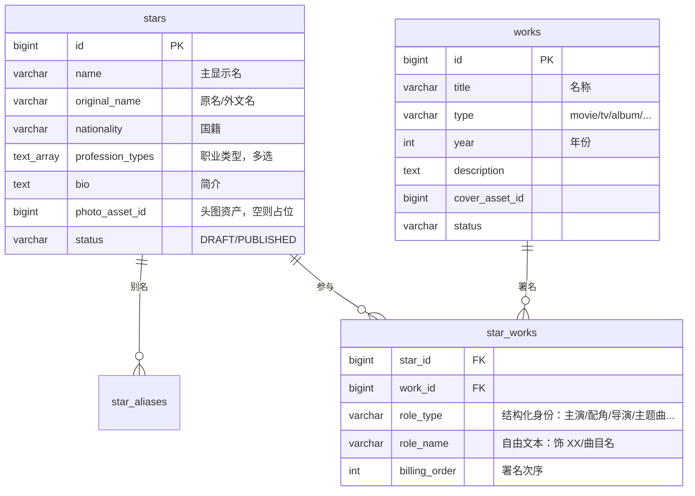

# 明星图鉴（人物与作品）设计稿

- 状态：**设计稿，待用户拍板；未拍板前不写业务代码。**
- 来源：用户 2026-10-14 需求单。
- 范围：人物（介绍/照片/职业类型/国籍/别名）、作品（名称/类型/年份）、人物与作品的多对多关系（关系行带角色身份）。与活动/场次的关联（出演阵容）列为待拍板项，不在第一版默认范围。

---

## 1. 数据模型

### 1.1 关系总览

### 1.2 `stars`（人物）

| 字段 | 类型 | 约束 | 说明 |
|---|---|---|---|
| `id` | BIGINT IDENTITY | PK | 全表统一 `BIGINT GENERATED ALWAYS AS IDENTITY`（迁移约定） |
| `name` | VARCHAR(200) | NOT NULL | 主显示名（中文优先） |
| `original_name` | VARCHAR(200) | NULL | 原名 / 外文名 |
| `nationality` | VARCHAR(100) | NOT NULL | 国籍。首版自由文本；需要按国籍筛选时再升级 ISO 3166 码表（待拍板 §4.2） |
| `profession_types` | TEXT[] | NOT NULL，应用层白名单 | 职业类型，多选：`actor` / `singer` / `director` / `musician` / `producer` / `screenwriter` / `dancer` / `host` / `model` 等；首版清单见 §4.2 |
| `bio` | TEXT | NULL | 简介，编辑录入并标注来源 |
| `photo_asset_id` | BIGINT | NULL | 头图，指向对象存储资产记录；NULL 时前端渲染占位图（§3 素材红线） |
| `status` | VARCHAR(20) | NOT NULL，`DRAFT` / `PUBLISHED` | 公开 API 只暴露 `PUBLISHED`（对齐 catalog/campaign 状态守卫） |
| `created_at` / `updated_at` | TIMESTAMPTZ | NOT NULL | `updated_at` 挂 `awn_set_updated_at()` 触发器 |

### 1.3 `star_aliases`（别名，子表）

别名用子表而非数组，便于搜索命中与唯一约束。

| 字段 | 类型 | 约束 | 说明 |
|---|---|---|---|
| `id` | BIGINT IDENTITY | PK | |
| `star_id` | BIGINT | FK → `stars`，NOT NULL，级联删除 | |
| `alias` | VARCHAR(200) | NOT NULL | 昵称 / 曾用名 / 外文名 |
| `kind` | VARCHAR(30) | NOT NULL | `nickname` / `former` / `english` |
| — | | UNIQUE(`star_id`, `alias`) | |

### 1.4 `works`（作品）

| 字段 | 类型 | 约束 | 说明 |
|---|---|---|---|
| `id` | BIGINT IDENTITY | PK | |
| `title` | VARCHAR(300) | NOT NULL | 名称 |
| `type` | VARCHAR(50) | NOT NULL，白名单 | `movie` / `tv` / `variety` / `stage` / `album` / `song` / `concert`（首版清单待拍板 §4.2） |
| `year` | INT | NULL | 年份；未知允许空，前端显示「年份未知」 |
| `description` | TEXT | NULL | |
| `cover_asset_id` | BIGINT | NULL | 封面图，同头图的授权约束 |
| `status` | VARCHAR(20) | NOT NULL，`DRAFT` / `PUBLISHED` | 同 `stars.status` |
| `created_at` / `updated_at` | TIMESTAMPTZ | NOT NULL | 同上 |

### 1.5 `star_works`（人物 ↔ 作品，关系行带属性——本模型核心）

多对多关系不扁平化成两端 id：**每行 = 一人在一部作品中的一种身份**。

| 字段 | 类型 | 约束 | 说明 |
|---|---|---|---|
| `star_id` | BIGINT | FK → `stars`，NOT NULL | |
| `work_id` | BIGINT | FK → `works`，NOT NULL | |
| `role_type` | VARCHAR(50) | NOT NULL，白名单 | 结构化身份：`cast_lead`（主演）/ `cast_supporting`（配角）/ `cast_cameo`（客串）/ `director` / `screenwriter` / `producer` / `composer` / `lyricist` / `theme_song`（演唱主题曲）/ `voice`（配音）等，首版清单待拍板 §4.2 |
| `role_name` | VARCHAR(200) | NOT NULL，默认空串 | 自由文本：饰「李逍遥」、主题曲《稻香》等 |
| `billing_order` | INT | NULL | 同组内署名次序，主演在前 |
| — | | UNIQUE(`star_id`, `work_id`, `role_type`, `role_name`) | 一人同一作品的多重身份各占一行（主演 + 演唱主题曲 = 两行）；同类型多首主题曲靠 `role_name` 区分 |
| — | | INDEX(`work_id`)、INDEX(`star_id`) | 作品详情页拉人员表 / 人物详情页拉作品列表 |

### 1.6 照片资产

- 对象存储沿用现有 RustFS（S3 兼容）通道；资产记录在现有 `campaign_assets` 模式上扩展或新建 `media_assets`（实现时定）。
- **每张人物照片必须带：来源 URL、授权状态、授权方式（书面授权 / 自有拍摄）、录入人**；字段缺失的图只能按占位图展示。
- 头图第一版单张（`photo_asset_id`）；相册（`star_photos` 子表）为扩展项，待拍板 §4.4。

### 1.7 模块归属（待拍板 §4.1）

推荐新建模块 `awn-star`（人物图鉴），理由：图鉴是编辑型内容数据，与 `awn-catalog` 的交易商品目录、`awn-event` 的活动场次语义不同；独立模块使边界与 `api` 包清晰。备选：并入 `awn-catalog`。

---

## 2. 页面结构

### 2.1 消费端（web / 小程序同构子集）

**入口**

1. 顶部导航新增「明星」入口 → 人物列表（第一版主入口）。
2. 活动页 / 专场页「出演阵容」区块 → 人名 → 人物详情（依赖人物与活动的关联，待拍板 §4.6；第一版可不做）。

**人物列表 `/stars`**

- 筛选：职业类型 chips、国籍；搜索框命中姓名与别名。
- 卡片：头图或占位图 + 姓名 + 职业标签。

**人物详情 `/stars/{id}`**

1. 头图区（缺图占位）。
2. 基本信息卡：姓名 / 原名 / 别名 / 国籍 / 职业标签。
3. 简介。
4. 参与作品列表：按作品类型分组（电影 / 剧集 / 综艺 / 音乐…），每行 = 作品名 + 年份 + 身份（`role_type` 中文标签 + `role_name`，如「主演 · 饰 李逍遥」「演唱主题曲《稻香》」）。
5. （待拍板项）相关演出：本站在售的活动入口。

**作品列表 `/works`**

- 筛选：类型、年份；搜索命中标题。

**作品详情 `/works/{id}`**

1. 封面 + 基本信息：名称 / 类型 / 年份 / 简介。
2. 人员表：按 `role_type` 分组（主演 / 配角 / 导演 / 编剧 / 音乐…），每行 = 人名 + `role_name`。

**互跳**：人物详情的作品行 → 作品详情；作品详情的人员行 → 人物详情。双向直达。

### 2.2 运营后台（admin）

- **明星管理**：列表 / 新建 / 编辑 / 发布（`DRAFT` → `PUBLISHED` 守卫）；照片上传时来源与授权字段必填，缺省只能保存为占位。
- **作品管理**：同上。
- **关系绑定**：作品详情内「添加人员」= 选人 + `role_type` 下拉 + `role_name` 文本 + `billing_order`；人物详情内提供反向只读列表。
- 鉴权沿用现有管理面模式（`X-Admin-Token` + 资源组限流）。

### 2.3 API 契约形状（实现阶段细化）

| 端点 | 说明 |
|---|---|
| `GET /api/v1/stars?profession=&nationality=&q=&page=` | 公开读，仅 `PUBLISHED` |
| `GET /api/v1/stars/{id}` | 详情 + 参与作品分组列表 |
| `GET /api/v1/works?type=&yearFrom=&yearTo=&q=&page=` | 公开读 |
| `GET /api/v1/works/{id}` | 详情 + 人员分组列表 |
| `POST/PUT /api/v1/admin/stars`、`/api/v1/admin/works` | 管理写，`X-Admin-Token` |
| `POST /api/v1/admin/works/{id}/cast` | 绑定人物与身份 |
| `POST /api/v1/admin/stars/{id}/publish`、`.../works/{id}/publish` | 发布守卫，对齐 `/admin/events/{code}/publish` |

---

## 3. 素材与授权红线（不可让步）

1. **不得生成明星肖像**，实现与运营流程均禁止；也不用品牌 logo 代餐任何人物 / 作品图。
2. 照片只允许三类来源：权方书面授权的官方宣传照（记录来源 URL 与授权方式）、自有拍摄、明确标注的占位图。
3. **缺图一律占位**：中性人形剪影（纯色几何，带「示意图」标注，复用原型 `demo-note` 机制）；绝不用生成人脸顶替。
4. 授权字段（来源 / 状态 / 录入人）缺失的图片，系统按占位图展示，不进入公开 API。
5. 简介文字编辑录入并标注来源，不做自动抓取生成。

---

## 4. 待拍板项

1. **模块归属**：新建 `awn-star`（推荐）vs 并入 `awn-catalog`。
2. **枚举清单**：`profession_types`、`works.type`、`star_works.role_type` 的首版白名单集（§1 给出建议值，拍板后冻结）。
3. **国籍存储**：自由文本（首版）vs ISO 3166 码表（需按国籍筛选时）。
4. **照片形态**：第一版单头图（推荐）vs 直接上相册子表。
5. **发布模式**：状态制 `DRAFT`/`PUBLISHED`（推荐首版）vs 专场式不可变 revision。
6. **人物 ↔ 活动 / 场次关联**（出演阵容区块）是否纳入第一版。
7. **页面视觉**：列表 / 详情 / 卡片的视觉稿随 Phase 07 原型口径统一，原型过目后对齐。
