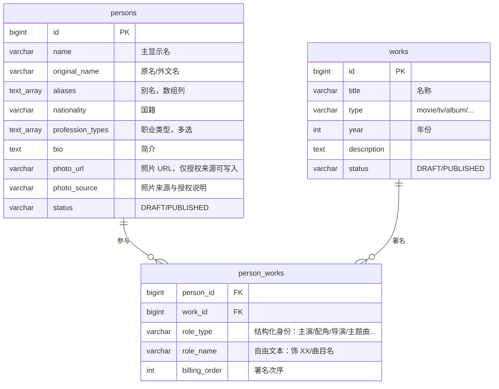

# 明星图鉴（人物与作品）设计稿

- 状态：**已拍板（用户 2026-10-14 授权代决）并已实现**；迁移 `V18__star_catalog_tables.sql`，模块 `awn-star`。
- 来源：用户 2026-10-14 需求单 + 同日拍板单（三表、关系实体、占位优先、主导航独立入口、基础检索）。
- 范围：人物（介绍/照片/职业类型/国籍/别名）、作品（名称/类型/年份）、人物与作品的多对多关系（关系行带角色身份）。与活动/场次的关联（出演阵容）列为待拍板项，不在第一版默认范围。

---

## 1. 数据模型

表名与列名按拍板单定：`persons` / `person_id`（拍板前草稿曾用 `stars` / `star_id`，已按拍板统一）。第一版三个表，别名用数组列，不建子表。

### 1.1 关系总览

### 1.2 `persons`（人物）

| 字段 | 类型 | 约束 | 说明 |
|---|---|---|---|
| `id` | BIGINT IDENTITY | PK | 全表统一 `BIGINT GENERATED ALWAYS AS IDENTITY`（迁移约定） |
| `name` | VARCHAR(200) | NOT NULL，非空白 | 主显示名（中文优先） |
| `original_name` | VARCHAR(200) | NULL | 原名 / 外文名，检索时与姓名同样大小写不敏感包含 |
| `aliases` | TEXT[] | NOT NULL，默认空数组 | 别名（昵称 / 曾用名 / 外文名）。数组列而非子表：第一版别名只参与检索，不需要独立生命周期 |
| `nationality` | VARCHAR(100) | NOT NULL | 国籍，首版自由文本，等值匹配且大小写不敏感；需要多语言映射时再升级 ISO 3166 码表 |
| `profession_types` | TEXT[] | NOT NULL，应用层白名单 | 职业类型，多选：`actor` / `singer` / `director` / `musician` / `producer` / `screenwriter` / `dancer` / `host` / `model` |
| `bio` | TEXT | NULL | 简介，编辑录入并标注来源 |
| `photo_url` | VARCHAR(500) | NULL | 人物照片。**写入必须有 `photo_source`**，否则 facade 拒绝创建 |
| `photo_source` | VARCHAR(500) | NULL | 来源与授权说明（权方书面授权 / 自有拍摄 / 占位图）。为空时公开视图不透出 `photo_url`，前端按占位图渲染 |
| `status` | VARCHAR(20) | NOT NULL，`DRAFT` / `PUBLISHED` | 公开 API 只暴露 `PUBLISHED`（对齐 catalog/campaign 状态守卫） |
| `created_at` / `updated_at` | TIMESTAMPTZ | NOT NULL | `updated_at` 挂 `awn_set_updated_at()` 触发器 |

照片第一版直接存 URL + 来源说明，不引入对象存储资产表；相册（`person_photos` 子表）为扩展项，待拍板 §4.4。

### 1.3 `works`（作品）

| 字段 | 类型 | 约束 | 说明 |
|---|---|---|---|
| `id` | BIGINT IDENTITY | PK | |
| `title` | VARCHAR(300) | NOT NULL | 名称 |
| `type` | VARCHAR(50) | NOT NULL，白名单 | `movie` / `tv` / `variety` / `stage` / `album` / `song` / `concert` |
| `year` | INT | NULL，年份 1900–2100 | 年份；未知允许空，前端显示「年份未知」 |
| `description` | TEXT | NULL | |
| `status` | VARCHAR(20) | NOT NULL，`DRAFT` / `PUBLISHED` | 同 `persons.status` |
| `created_at` / `updated_at` | TIMESTAMPTZ | NOT NULL | 同上 |

第一版作品不配封面图。

### 1.4 `person_works`（人物 ↔ 作品，关系行带属性——本模型核心）

多对多关系不扁平化成两端 id：**每行 = 一人在一部作品中的一种身份**。

| 字段 | 类型 | 约束 | 说明 |
|---|---|---|---|
| `person_id` | BIGINT | FK → `persons`，NOT NULL，级联删除 | |
| `work_id` | BIGINT | FK → `works`，NOT NULL，级联删除 | |
| `role_type` | VARCHAR(50) | NOT NULL，白名单 | 结构化身份：`cast_lead`（主演）/ `cast_supporting`（配角）/ `cast_cameo`（客串）/ `director` / `screenwriter` / `producer` / `composer` / `lyricist` / `theme_song`（演唱主题曲）/ `voice`（配音）等 |
| `role_name` | VARCHAR(200) | NOT NULL，默认空串 | 自由文本：饰「沈砚」、主题曲《长风》等。用空串而非 NULL，UNIQUE 约束才不会因 NULL 放水 |
| `billing_order` | INT | NULL | 同组内署名次序，主演在前 |
| — | | UNIQUE(`person_id`, `work_id`, `role_type`, `role_name`) | 一人同一作品的多重身份各占一行（主演 + 演唱主题曲 = 两行）；同类型多首主题曲靠 `role_name` 区分 |
| — | | INDEX(`work_id`)、INDEX(`person_id`) | 作品详情页拉人员表 / 人物详情页拉作品列表 |

### 1.5 模块归属

新建模块 `awn-star`：图鉴是编辑型内容数据，与 `awn-catalog` 的交易商品目录、`awn-event` 的活动场次语义不同；独立模块使边界与 `api` 包清晰。模块只依赖 `awn-shared`，不引用其他业务模块。

---

## 2. 页面结构

### 2.1 消费端（web / 小程序同构子集）

**入口**

1. 顶部导航新增「明星」入口 → 人物列表（第一版主入口）。
2. 活动页 / 专场页「出演阵容」区块 → 人名 → 人物详情（依赖人物与活动的关联，待拍板 §4.6；第一版可不做）。

**人物列表 `/stars`**

- 筛选：职业类型 chips、国籍；搜索框命中姓名与别名。
- 卡片：头图或占位图 + 姓名 + 职业标签。

**人物详情 `/stars/{id}`**

1. 头图区（缺图占位）。
2. 基本信息卡：姓名 / 原名 / 别名 / 国籍 / 职业标签。
3. 简介。
4. 参与作品列表：按作品类型分组（电影 / 剧集 / 综艺 / 音乐…），每行 = 作品名 + 年份 + 身份（`role_type` 中文标签 + `role_name`，如「主演 · 饰 李逍遥」「演唱主题曲《稻香》」）。
5. （待拍板项）相关演出：本站在售的活动入口。

**作品列表 `/works`**

- 筛选：类型、年份；搜索命中标题。

**作品详情 `/works/{id}`**

1. 封面 + 基本信息：名称 / 类型 / 年份 / 简介。
2. 人员表：按 `role_type` 分组（主演 / 配角 / 导演 / 编剧 / 音乐…），每行 = 人名 + `role_name`。

**互跳**：人物详情的作品行 → 作品详情；作品详情的人员行 → 人物详情。双向直达。

### 2.2 运营后台（admin）

- **明星管理**：列表 / 新建 / 编辑 / 发布（`DRAFT` → `PUBLISHED` 守卫）；照片上传时来源与授权字段必填，缺省只能保存为占位。
- **作品管理**：同上。
- **关系绑定**：作品详情内「添加人员」= 选人 + `role_type` 下拉 + `role_name` 文本 + `billing_order`；人物详情内提供反向只读列表。
- 鉴权沿用现有管理面模式（`X-Admin-Token` + 资源组限流）。

### 2.3 API 契约形状（实现阶段细化）

| 端点 | 说明 | 状态 |
|---|---|---|
| `GET /api/v1/stars?profession=&nationality=&q=` | 公开读，仅 `PUBLISHED` | 已实现 |
| `GET /api/v1/stars/{id}` | 详情 + 参与作品列表（含身份） | 已实现 |
| `GET /api/v1/works?type=&q=` | 公开读 | 已实现 |
| `GET /api/v1/works/{id}` | 详情 + 人员表（按 `role_type` 分组） | 已实现 |
| `POST /api/v1/admin/stars`、`POST /api/v1/admin/works` | 管理建草稿，`X-Admin-Token` | 已实现 |
| `POST /api/v1/admin/works/{id}/cast` | 绑定人物与身份 | 已实现 |
| `POST /api/v1/admin/stars/{id}/publish`、`/api/v1/admin/works/{id}/publish` | 发布守卫，对齐 `/admin/events/{code}/publish` | 已实现 |
| 编辑更新（`PUT`）、分页（`page=`） | 第一版未做：列表返回全量，写入只建草稿 | 待拍板 §4.5 |

---

## 3. 素材与授权红线（不可让步）

1. **不得生成明星肖像**，实现与运营流程均禁止；也不用品牌 logo 代餐任何人物 / 作品图。
2. 照片只允许三类来源：权方书面授权的官方宣传照（记录来源 URL 与授权方式）、自有拍摄、明确标注的占位图。
3. **缺图一律占位**：中性人形剪影（纯色几何，带「示意图」标注，复用原型 `demo-note` 机制）；绝不用生成人脸顶替。
4. 授权字段（来源 / 状态 / 录入人）缺失的图片，系统按占位图展示，不进入公开 API。
5. 简介文字编辑录入并标注来源，不做自动抓取生成。

---

## 4. 待拍板项

已拍板（2026-10-14 授权代决，按 §1 与 §2 的推荐项落地）：模块归属新建 `awn-star`；状态制 `DRAFT`/`PUBLISHED`；国籍存自由文本；照片第一版单张 URL + 来源说明。枚举白名单已冻结在 `StarCatalogTypes`：`PROFESSIONS` / `WORK_TYPES` / `ROLE_TYPES`。

仍未拍板：

1. **人物 ↔ 活动 / 场次关联**（出演阵容区块）是否纳入第一版。
2. **页面视觉**：列表 / 详情 / 卡片的视觉稿随 Phase 07 原型口径统一，原型过目后对齐。
3. **编辑能力**：更新（`PUT`）、删除、分页与列表规模控制——第一版列表返回全量，人物与作品规模上来后需要补。
